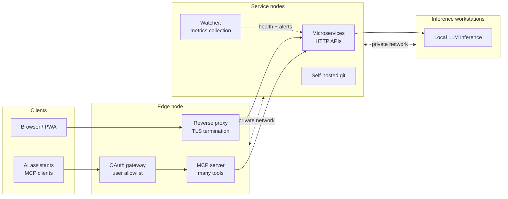

# Case study: a self-hosted, multi-node AI platform for small-business operations

**Context.** For small-business operations I wanted AI assistance across
day-to-day work (documents, monitoring, task management, reporting),
under three constraints: sensitive data stays on hardware I own wherever
possible, everything runs on infrastructure I control, and how an assistant
behaves can be changed without changing code.

**My role.** I designed, built and operate the full platform end to end:
networking, deployment, services, the AI integration layer and the
observability that sits on top.

## Architecture

- **Network.** Every node joins an encrypted private network, so internal
  services are not reachable from the internet. An edge node terminates TLS and routes only the
  public paths that are actually needed.
- **Deployment.** Each service is a container, declared as code and versioned in
  a self-hosted git server, so a deployment is repeatable.
- **AI layer.** An MCP server wraps the services' HTTP APIs as typed tools,
  so assistants act through the same APIs as the web UI, never through the
  database. External AI clients go through an OAuth gateway: they sign in with an
  identity provider, and only allowlisted users can call tools.
- **Models.** Open-weight models run locally on the workstations, with hosted
  models where needed. A central registry maps model aliases to providers and
  models; each agent declares its alias and a fallback order.

## Problems worth telling

**1. Agents degraded silently.** Several features that use LLM agents got
noticeably worse over time. The prompts were buried in code and there was no
way to measure a change before shipping it.
*Fix:* each agent's prompt, model order and output contract moved into an
editable file, validated at runtime with retry-on-error and model fallback.
Agents got human-reviewed golden sets, versioned in git, and a regression check.
(Public reimplementations: [agentkit-lite](https://github.com/remiliorc/agentkit-lite),
[agent-eval-bench](https://github.com/remiliorc/agent-eval-bench).)

**2. "Running" is not "working".** After a restart of one network
component, the reverse proxy stayed up but silently stopped routing until it
was recreated.
*Fix:* a documented recovery procedure, plus a health check that catches it.
This led to the next item.

**3. A service can disappear without anyone noticing.** Restart policies
protect against crashes, not deletions: a service was removed and nobody noticed
for days, silently breaking the features that depended on it.
*Fix:* a watcher that auto-discovers what is declared (containers and services)
and compares it with what is actually running, alerts only when the set of
problems changes (recoveries included), and sends a daily heartbeat so that
silence never means "all OK". Node and application metrics are now collected
centrally as the basis for anomaly detection.
(Public reimplementation, extended with debounced alerts and EWMA anomaly
detection: [stack-sentinel](https://github.com/remiliorc/stack-sentinel).)

**4. Exposing tools to external assistants.** Giving a third-party AI client
access to internal tools needed authentication without adding auth code to
every service.
*Fix:* an OAuth gateway in front of the MCP server: clients sign in with an
external identity provider, and only allowlisted users can call tools.
(The public reimplementation goes further, with per-tool scopes, no token
passthrough and an argument-free audit log:
[mcp-auth-gateway](https://github.com/remiliorc/mcp-auth-gateway).)

**5. Name resolution conflicts** between two network clients on a shared
workstation broke internal name resolution.
*Fix:* explicit resolver configuration and documented precedence rules.

## Outcome

- Dozens of services across several nodes, operated by one person.
- External assistants can only call tools after signing in, and only as allowlisted users.
- Prompt and model changes are versioned and checked against human-reviewed golden sets.

## What I would do differently

- Introduce the golden sets on day one, not after the first regression.
- Go from a user allowlist to per-tool scopes and an audit log at the gateway
  sooner (the public reimplementation already does this).

---
*For confidentiality, the names of products, providers, hosts and clients are
omitted, and addresses and counts are generalized. The linked repositories are
smaller, independent implementations of the same ideas, written from scratch
for publication, with synthetic data.*
